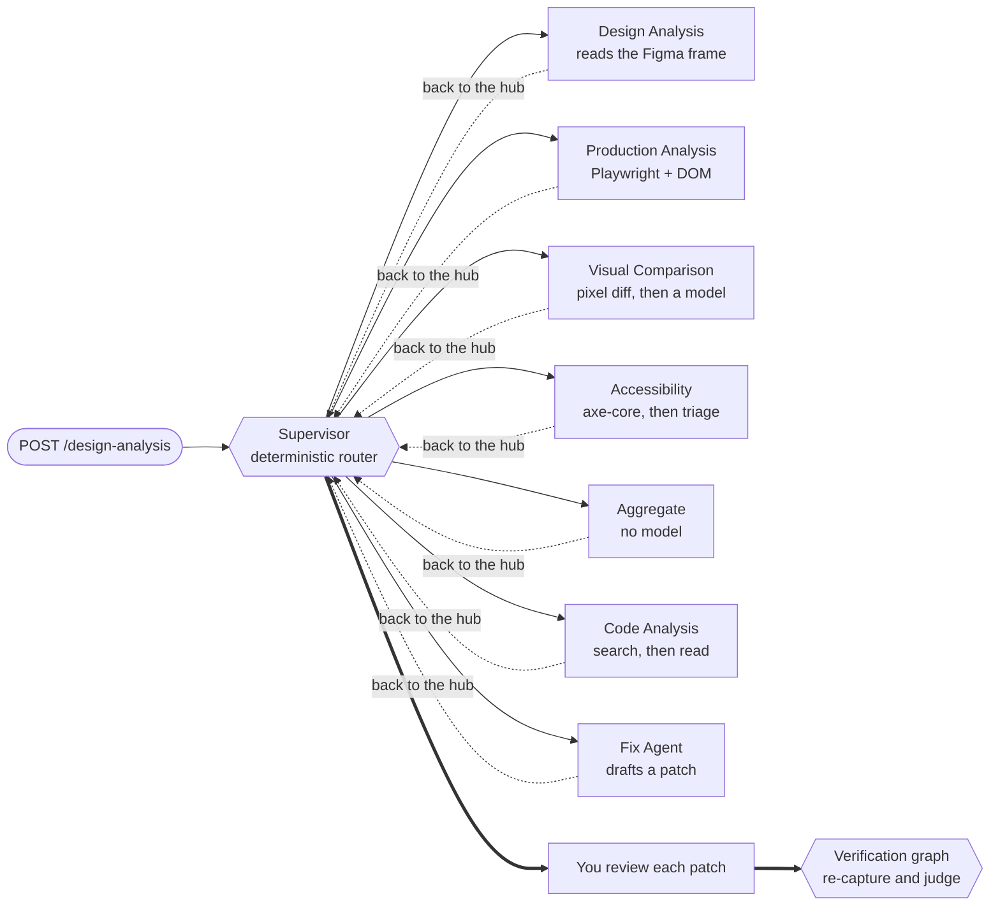

<div align="center">

# Design Drift

### Your design said one thing. Your app shipped another. This finds the difference and writes the patch.

Multi-agent design QA: reads a Figma frame, opens your real page in a real
browser, reports what drifted, traces it to the line of code, and drafts a
fix you approve.

**[Live demo](https://design-drift-weld.vercel.app/app)** - no sign-up,
opens on a real agent run, saved so you can read it.

[](https://github.com/gauri2029/design-drift/actions/workflows/ci.yml)
[](#tested-by-trying-to-break-it)
[](https://www.python.org/)
[](https://fastapi.tiangolo.com/)
[](https://react.dev/)
[](https://www.langchain.com/langgraph)
[](https://mypy-lang.org/)
[](LICENSE)

</div>

---

## The 30-second version

Design QA is normally a person with two tabs open, flicking between a Figma
frame and a staging URL. It is slow, inconsistent between reviewers, and the
output ("the hero spacing looks off") rarely survives contact with a
codebase.

Design Drift does the tedious half and leaves the judgement to you:

| | |
|---|---|
| **Reads the design** | Pulls the Figma node and works out what it was meant to look like |
| **Opens the real page** | Playwright, several viewport widths, plus axe-core against the live DOM |
| **Reports what drifted** | Pixel diff *and* a multimodal model reading it, triaged by severity |
| **Finds the code** | Searches the repo and names the file and line range responsible |
| **Drafts the patch** | A diff, shown to you, applied to nothing |
| **Verifies the fix** | Re-captures after you rebuild and says whether it actually worked |

<!-- SCREENSHOTS, drop files into docs/images/ and delete the comment markers.
     Suggested, in this order:
       drift.png        the Drift view: design vs live, side by side
       findings.png     the triaged findings list
       fix.png          a proposed patch with the Approve control
     A GIF of one run (run.gif) can replace all three.


-->

It never commits, never pushes, never opens a pull request. The GitHub App's
permission is `Contents: read-only`, so a write is impossible rather than
merely absent from the code. You export the patch and apply it yourself.

---

## What makes it more than a prompt

**The router is code, not a model.** The supervisor is a pure function over
typed state: a cascade of "is this field still empty?" checks. No prompt, no
tool-calling, no model import. Routing is therefore free, deterministic, and
unit-testable without mocking an LLM.

**Every verdict sits on a measurement.** The pixel diff, the axe-core report,
the before/after mismatch percentages and the "did the page actually change?"
flag are all computed in Python. The model interprets those numbers; it never
substitutes for them.

**A patch is checked before it is shown.** The Fix agent quotes the code it
intends to replace, and Python verifies that text is really in the file at
those lines. A patch that reads plausibly but does not apply is shown
flagged, not silently offered.

**Findings are structured, not prose.** Typed Pydantic models end to end, so
the frontend renders fields rather than parsing paragraphs.

---

## Architecture

Two LangGraph graphs. One inspects and proposes; the second verifies after a
fix lands.



A **hub-and-spoke** topology: every worker has exactly one edge back to the
supervisor, and all sequencing lives in one conditional. Adding an eighth
agent means one branch in one function, and no existing node changes.

Two real forks, not a fixed script: code analysis is skipped when nothing was
found or the project has no checkout, and the fix is skipped when every
finding came back unlocated.

→ [docs/architecture.md](docs/architecture.md) for the state shape, the node
contracts and the data flow.

---

## Tech stack

| Layer | Choices |
|---|---|
| **Agents** | LangGraph · Gemini / Claude (swappable behind one interface) · structured Pydantic outputs |
| **Inspection** | Playwright (Chromium) · axe-core · pixelmatch · Pillow |
| **API** | FastAPI · async SQLAlchemy 2 · PostgreSQL 16 · Alembic (20 migrations) · SSE |
| **Frontend** | React 19 · TypeScript (strict) · Vite · Tailwind v4 |
| **Auth** | argon2 (argon2-cffi) · JWT bearer tokens · per-user ownership enforced in queries |
| **Quality** | ruff · mypy `--strict` · pytest · Vitest · GitHub Actions |
| **Deploy** | Vercel (static) · Render (Docker, Chromium) · managed Postgres · persistent disk |

Dependencies are added for a reason, not by default: there is no state
library, no router library, and no component library.

---

## Quick start

Needs Docker, Python 3.12+ with [uv](https://docs.astral.sh/uv/), and Node 22+.

```bash
git clone https://github.com/gauri2029/design-drift && cd design-drift
cp .env.example .env          # add FIGMA_ACCESS_TOKEN and GEMINI_API_KEY

docker compose -f infra/docker/docker-compose.yml up -d postgres

cd backend && uv sync && uv run playwright install chromium
uv run alembic upgrade head
uv run uvicorn app.main:app --reload       # :8000

cd ../frontend && npm install && npm run dev    # :5173
```

Sign up, add a project (a Figma file key, a node id, the URL that should
match it), and press **Run check**. A run opens a browser and calls a model,
so it never starts on its own.

```bash
# the checks CI runs
cd backend  && uv run ruff check app/ tests/ && uv run mypy app/ && uv run pytest
cd frontend && npm run lint && npm run typecheck && npm test && npm run build
```

---

## The live demo

<https://design-drift-weld.vercel.app/app> - no sign-up, opens straight into
the workspace.

It shows a **real** run against a real deployed site: the findings, the
located files and line numbers, the proposed patch, and the verification
verdict, all produced by the agents and stored. The patch export works; the
file it hands you is the genuine diff.

What is switched off is starting a *new* run, because that launches a browser
and calls a model, and a public URL that lets anyone do that spends the
author's API budget on whoever finds it. Those actions are refused by the API
itself (on the owner of the data, not on the caller), so the lock holds for
an anonymous visitor and for a signed-in stranger alike. The app says which
is which on screen rather than letting you find out from an error.

Sign up to point the agents at your own Figma frame and page, where
everything runs live.

---

## Security

- **Ownership is enforced in the query, not the UI.** `get_project` requires
  an `owner_id`, so forgetting it is a type error rather than a silent hole.
  Cross-account access is a 404, never a 403. A 403 would confirm the id is
  real.
- **GitHub is read-only by permission** (`Contents: read`). Public
  repositories only: private-repo LLM analysis is deliberately deferred,
  because the free-tier Gemini data terms may not protect confidential code.
- **Each run clones into its own workspace**, outside the repo and
  gitignored. Repository code is never executed: it is searched and read.
- **Path traversal is closed at both ends**: source paths resolve inside a
  configured root, symlinks are skipped, and storage keys that escape the
  root raise.
- **The API refuses to start unsafe**. A default JWT secret, a wildcard
  `CORS_ORIGINS` or an empty one is a startup error outside local, not a
  warning in a log nobody reads.
- **Secrets stay out of the repo and out of the environment** where it
  matters: the GitHub App key is referenced by path, never by value.

---

## Tested by trying to break it

**381 tests** (340 backend, 41 frontend), and the ones that matter were
verified by mutation: break the property on purpose, confirm a test fails,
put it back.

That process earned its keep. It caught a `fix-review` route that reached the
wrong guard, a demo gate wrongly applied to an image route, and a pair of
tests that passed for the wrong reason until the fixture was pinned. Each is
now a named test.

Also covered: a symlink escape (demonstrated, then closed), an
`InvalidHashError` that would have 500'd login, three scan routes that were
authenticated but not authorized, and an eval harness whose `main()` returned
0 unconditionally and so could never fail.

CI runs lint, strict type checking, both suites, a retrieval eval with a
minimum-accuracy gate, a frontend build, and a production Docker build that
asserts Chromium launches, no dev dependencies ship, and the container is
not root.

---

## Future work

**Agent-generated draft pull requests.** Today you review the patches,
approve the ones you want, and export a diff to apply yourself. Next: the
same approved patches opened as a **draft** PR on a branch. Draft, on a
branch, never to the default branch, and still only after the human approval
step. That requires a write scope the App does not currently hold, which is
the point: the boundary moves deliberately, not by accident.

Also queued: per-component analysis rather than whole-page, project sharing
(the ownership check is already the single place that would change), and
S3-backed storage behind the existing `StorageBackend` protocol.

---

## Docs

| | |
|---|---|
| [docs/architecture.md](docs/architecture.md) | State shape, node contracts, data flow |
| [docs/principles.md](docs/principles.md) | The seven rules this codebase is held to |
| [docs/deployment.md](docs/deployment.md) | Vercel + Render, step by step, with the manual bits named |
| [backend/README.md](backend/README.md) | API layout and local workflows |
| [frontend/README.md](frontend/README.md) | Component structure |

<div align="center">
<sub>MIT licensed. Built as a learning project, one vertical slice per commit.</sub>
</div>
