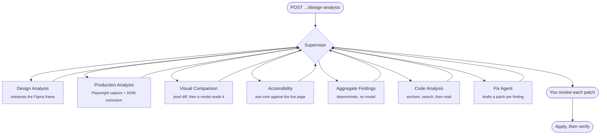

<div align="center">

# Design Drift

### AI design QA that tells you where your app stopped matching its design

Designers hand off a Figma frame. Months later nobody is quite sure which
parts of the live site still match it. Design Drift answers that question,
in plain language, and traces each difference back to the line of code
behind it.

[](https://github.com/gauri2029/design-drift/actions/workflows/ci.yml)
[](https://www.python.org/)
[](https://fastapi.tiangolo.com/)
[](https://react.dev/)
[](https://www.typescriptlang.org/)
[](https://www.langchain.com/langgraph)
[](https://www.postgresql.org/)
[](LICENSE)

</div>

---

## The problem

Design QA is usually a person with two browser tabs open, flicking between
them. It is slow, it is inconsistent between reviewers, and the findings
that come out of it ("the hero spacing looks off") are rarely specific
enough to act on without a second round of investigation.

The parts that are tedious are also the parts a machine is good at:
capturing the same page at several widths, diffing it against a design,
running an accessibility audit, and searching a codebase for the markup
responsible. The part that genuinely needs judgement, deciding whether a
proposed change is right, stays with you.

That split is the whole design of this project.

## What it actually does

Give it a Figma frame and a URL. It will:

- read the design and work out what it was meant to look like
- open your real page in a browser, capture it at several widths, and run
  an accessibility audit against the live DOM
- report the differences that matter, each one ranked by whether it should
  block a release
- trace a finding to the file and lines responsible
- draft a patch, show it to you as a diff, and wait
- after you approve and rebuild, re-capture the page and tell you whether
  the issue is actually resolved or whether something else broke

It never commits, never pushes, and never opens a pull request. When a fix
is ready you download it as a patch file and apply it yourself. That is a
deliberate boundary, not a missing feature.

## How it works

Two LangGraph workflows. One inspects and proposes, one verifies after a
fix lands.



A supervisor decides what runs next from the state it can see, rather than
a fixed script. If a project has no source checkout, code analysis and the
fix agent are skipped and the run still produces findings. If aggregation
decides nothing is wrong, the run ends there instead of paying for two more
model calls.

### Design decisions worth knowing about

**Deterministic work is not given to a model.** The pixel diff, the
accessibility scan, the ranking, and the file search are all ordinary code.
Models are used where judgement is genuinely needed: reading a design,
interpreting a diff, drafting a patch. This keeps results reproducible and
costs low.

**Structured output everywhere.** Every model call returns a validated
Pydantic model, never prose that something downstream has to parse.

**Retrieval is measured, not assumed.** A small eval harness scores the
code-location path against hand-verified answers. It currently sits at
**11/12 (92%)**, and CI fails if that number drops. It found three real
ranking bugs on its first run that the unit tests could not see, because
each component was behaving exactly as written.

**Nothing destructive happens without you.** Patches are shown as diffs
against your real files. Applying one writes a backup first. Deleting a
project asks you to type its name.

## Features

| | |
|---|---|
| **Figma to live page** | Compares a specific frame against a specific URL, at the frame's own width |
| **Four inspection agents** | Design, production, visual comparison, accessibility |
| **Code location** | Traces a finding to a file and line range using anchors extracted from the finding itself |
| **Proposed fixes** | A real diff per finding, with a confidence level and an explanation |
| **Human approval** | Per-finding approve or skip, before anything is written |
| **Verification** | Re-captures after a rebuild and reports what resolved, what did not, and what regressed |
| **Patch export** | Download the applied change as a `git apply` ready file |
| **GitHub integration** | Connect a repository through a read-only GitHub App instead of copying source by hand |
| **Accounts** | Email and password sign-in, with every project scoped to its owner |
| **Live progress** | Server-sent events stream each step as it finishes |

## Security and privacy

This reads your source code and sends parts of it to a model provider, so
the boundaries are explicit:

- **The GitHub App is read-only.** It holds `Contents: read` and nothing
  else, so pushes and pull requests are refused by GitHub itself, not just
  absent from the code.
- **Tokens are never stored.** Installation tokens are minted per operation
  from the App's private key and discarded. A database dump contains
  nothing that can reach a repository.
- **Repositories are cloned into an isolated workspace**, one per analysis
  run, outside the project tree and gitignored.
- **Only UI source files are ever read.** An allowlist of twelve
  extensions, so `.env` files, keys, and build output are excluded by
  never having been included. Symlinks are skipped, so a checkout cannot
  read outside itself.
- **Repository content is never executed.** Clones run with hooks and LFS
  filters disabled.
- **Projects are owner-scoped in the backend**, not hidden in the UI. Another
  account's project returns 404 rather than 403, so a guessed id tells an
  attacker nothing.
- **Private repositories are deferred** for now. Analysis sends snippets to
  a third-party model, and the free Gemini tier's terms are not suitable
  for confidential code.

## Technology

**Backend** Python 3.12, FastAPI, LangGraph, async SQLAlchemy over
PostgreSQL 16, Pydantic v2, Playwright, axe-core, Pillow and pixelmatch,
Alembic, managed with `uv`.

**Frontend** React 19, TypeScript in strict mode, Vite, Tailwind v4 with
CSS-first theming, Vitest and Testing Library.

**Models** Anthropic Claude by default, with Google Gemini as a free-tier
option for local development. Both go through one `generate_structured()`
seam, so switching provider is an environment variable.

## Quick start

**You will need** Docker, Node 20+, Python 3.12+, and
[`uv`](https://docs.astral.sh/uv/).

```bash
# 1. Configure
cp .env.example .env
#    FIGMA_ACCESS_TOKEN   https://www.figma.com/developers/api#access-tokens
#    ANTHROPIC_API_KEY    or GEMINI_API_KEY for the free tier
#    JWT_SECRET_KEY       openssl rand -hex 32

# 2. Database
docker compose -f infra/docker/docker-compose.yml up -d postgres

# 3. Backend
cd backend
uv sync
uv run playwright install chromium
uv run alembic upgrade head
uv run uvicorn app.main:app --reload

# 4. Frontend, in a second terminal
cd frontend
npm install
npm run dev
```

Open http://localhost:5173, create an account, and add your first project.

| | |
|---|---|
| Frontend | http://localhost:5173 |
| API health | http://localhost:8000/api/v1/health |
| API docs | http://localhost:8000/docs |

### Connecting a GitHub repository

Optional. Without it, point a project at a folder inside `SOURCE_ROOT`
instead and everything else works the same.

Create a GitHub App at https://github.com/settings/apps/new with
**Contents: Read-only**, webhooks off, and a Setup URL of
`http://localhost:5173`. Generate a private key, then set `GITHUB_APP_ID`,
`GITHUB_APP_PRIVATE_KEY_PATH`, and `GITHUB_APP_SLUG` in `.env`.

Leave them blank and the GitHub options simply do not appear.

## Testing

```bash
cd backend
uv run pytest                                      # 311 tests
uv run ruff check app/ tests/ && uv run mypy app/
uv run python -m app.evals.retrieval --search-only # free, no model calls

cd frontend
npm run lint && npm run typecheck && npm test      # 34 tests
```

CI runs all of it on every pull request, using only checks that cost
nothing: no model calls, no paid services.

Security properties are tested as attacks rather than as features. Each
test is something someone could try, and the assertion is that it does not
work: reading another account's project, reaching a repository through an
installation you did not link, escaping the workspace with a symlink,
leaking a token through a failed clone.

## Repository layout

```
backend/
  app/
    agents/        LangGraph nodes: one job each
    graph/         Workflow definitions and typed state
    tools/         Deterministic helpers: repo search, anchors, patching
    integrations/  Figma, Playwright, axe, GitHub, storage, model clients
    services/      Orchestration between routes and agents
    api/v1/        FastAPI routes
    evals/         Retrieval scoring harness
  tests/           311 tests
frontend/
  src/
    components/    The workspace, drift canvas, issue list, landing page
    hooks/         Auth, projects, analyses
    lib/           API client, issue model, motion primitives
docs/
  architecture.md  How the pieces fit and why
  principles.md    The rules this project is built to
```

## Two kinds of agents

This repository contains both, and they do not overlap.

| | **Runtime agents** | **Claude Code agents** |
|---|---|---|
| What | Supervisor, Design Analysis, Production Analysis, Visual Comparison, Accessibility, Code Analysis, Fix, Verification | `architecture-agent`, `backend-agent`, `frontend-agent`, and others in `.claude/agents/` |
| Purpose | Detect and remediate design drift, which is what the product does | Help build Design Drift, which is development tooling |
| Documented in | [`docs/architecture.md`](docs/architecture.md) | `.claude/agents/*.md` |

## Principles

The full set is in [`docs/principles.md`](docs/principles.md). The ones
that shaped the most code:

1. **Build one vertical slice at a time.** Every phase ends with something
   that runs end to end.
2. **No fake AI.** If a rule can compute it, a rule computes it.
3. **Understandable over clever.** Someone should be able to read a run and
   say why it reached its conclusion.
4. **Structured state, not prose.** Agents exchange typed objects.
5. **Humans decide anything consequential.** The tool never writes to your
   git history.
6. **Add technology only with a reason.** No Redis, no vector store, no RAG
   until a phase actually needs one.

## License

MIT. See [LICENSE](LICENSE).
